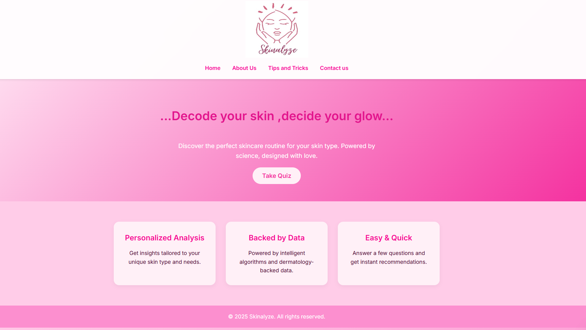

# ✨ Skinalyze – AI-Based Skincare Analysis & Recommendation System

**Skinalyze** is a Flask-based web application developed as my first academic project during my diploma journey. It explores the integration of Machine Learning and Web Development to provide skincare routine recommendations based on user-provided information.

The application analyses details such as skin type, skin concerns, skincare habits, and lifestyle choices to generate a personalised skincare routine.

## 🌸 Features

* **Interactive Skincare Quiz:** Collects information about users' skin types, concerns, and lifestyle habits.
* **Skin Analysis:** Analyses user responses to identify a skincare category.
* **Machine Learning Classification:** Uses a Decision Tree Classifier for classification.
* **Personalised Recommendations:** Generates skincare routine suggestions based on the analysis.
* **Informational Pages:** Includes skincare tips, an About page, and a Contact page.

## 🛠️ Technologies Used

| Category             | Technologies          |
| -------------------- | --------------------- |
| Programming Language | Python                |
| Backend Framework    | Flask                 |
| Machine Learning     | Scikit-learn          |
| Numerical Computing  | NumPy                 |
| Frontend             | HTML, CSS, JavaScript |
| Version Control      | Git and GitHub        |

## 🧠 Machine Learning Approach

Skinalyze uses a Decision Tree Classifier to classify user responses into predefined skincare categories.

The model uses features derived from user inputs, including age, skin type, skin concerns, sunscreen usage, cleansing habits, diet, and sleep patterns.

**Note:** This is an educational prototype. Its classifier uses a small synthetic dataset and its recommendations are not clinically validated or intended to replace professional dermatological advice.

## 📂 Project Structure

## 📂 Project Structure

```text
Skinalyze/
│
├── app.py
├── requirements.txt
├── .gitignore
│
├── static/
│   ├── logo4.png
│   ├── script.js
│   ├── style.css
│   
│
├── templates/
│   ├── about.html
│   ├── contact.html
│   ├── home.html
│   ├── index.html
│   ├── result.html
│   └── tips.html
│
└── demo/
    ├── Demo for linkedIn.mp4
    └── Skinalyze code vid.mp4
```


## ⚙️ Installation and Setup

Follow these steps to run Skinalyze locally.

**1. Clone the repository**

git clone https://github.com/Mugdha-AI09/Skinalyze.git

**2. Navigate to the project directory**

cd Skinalyze

**3. Create a virtual environment**

python -m venv venv

**4. Activate the virtual environment**

For Windows:

venv\Scripts\activate


**5. Install the required dependencies**

pip install -r requirements.txt

**6. Run the application**

python app.py

**7. Open the application**

Visit the following address in your browser:

http://127.0.0.1:5000/

## 📸 Application Screenshots

### 1. Homepage



### 2. Skincare Quiz


### 3. Tips and Tricks


## 🎥 Project Demonstrations

* [Skinalyze – Application Demo](demo/Demo%20for%20linkedIn.mp4)
* [Skinalyze – Code Walkthrough](demo/Skinalyze%20code%20vid.mp4)

## 🎯 Learning Outcomes

Through this project, I gained practical experience in:

* Python programming and Flask application development.
* Implementing a basic Machine Learning classification model.
* Integrating Machine Learning with a web application.
* Developing interactive web interfaces using HTML, CSS, and JavaScript.
* Organising project files and using GitHub for version control.

## 👩‍💻 Developed By

**Mugdha Pawar**

AI & Machine Learning Diploma Student

GitHub: [Mugdha-AI09](https://github.com/Mugdha-AI09)

---

*Skinalyze marks the beginning of my journey into Artificial Intelligence, Machine Learning, and Software Development.*
